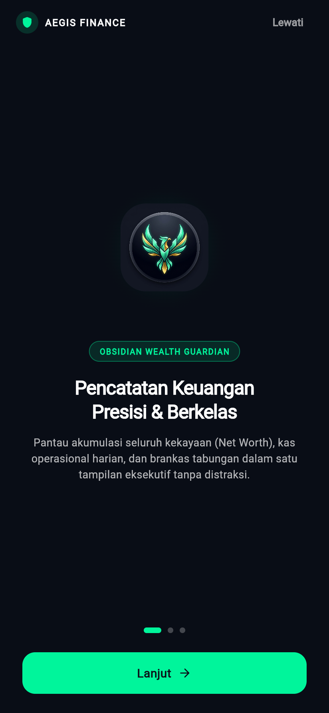
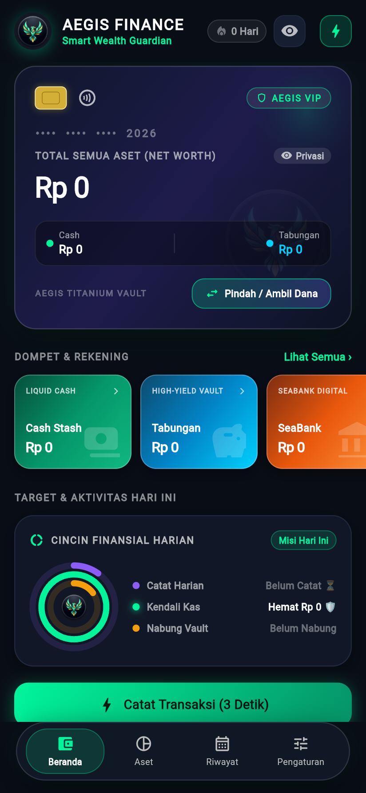
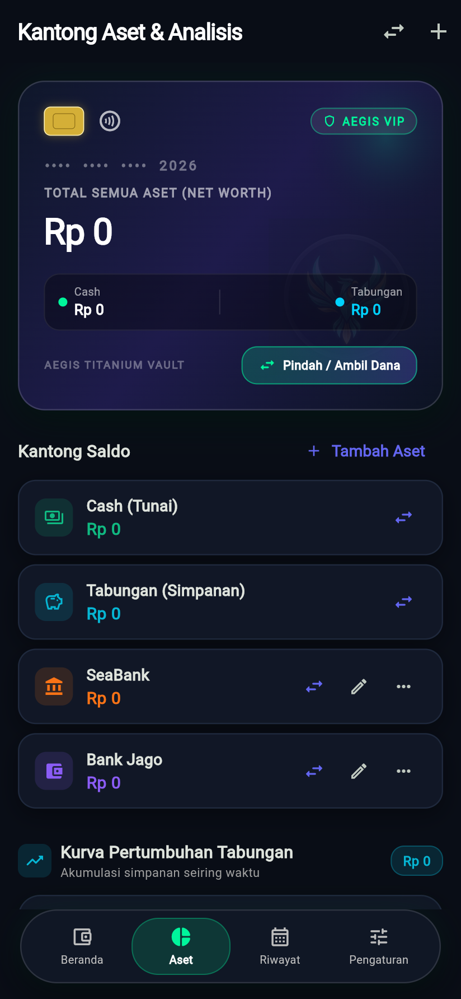
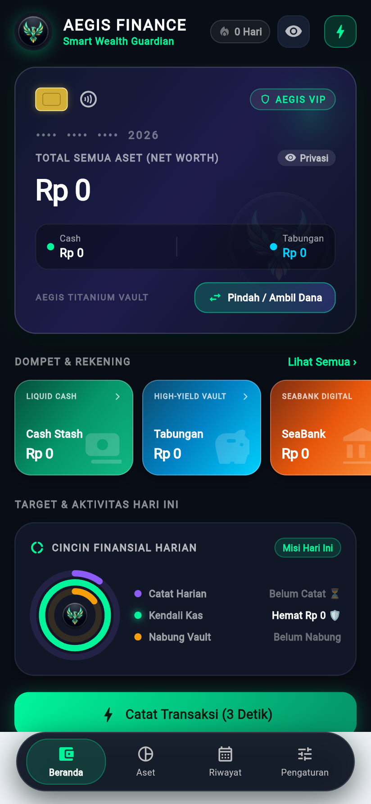
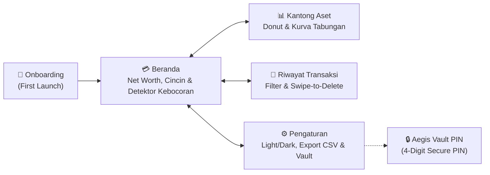

<p align="center">
  
</p>

<h1 align="center">🛡️ Aegis Finance</h1>

<p align="center">
  <strong>Smart Wealth Guardian & 100% Offline-First Personal Finance</strong><br>
  Aplikasi pembukuan keuangan modern dengan estetika <em>Obsidian Cosmic</em>, visual cincin aktivitas finansial ala <em>Apple Watch</em>, dan brankas privasi <em>Aegis Security Vault</em>.
</p>

<p align="center">
  
  
  
  
  
  
</p>

---

## 📥 Download Installer (APK Siap Pakai)

Tidak perlu setup Flutter atau compile source code dari nol. Unduh APK resmi dan pasang langsung di HP Android Anda:

<p align="center">
  <a href="https://github.com/M-Aqilaz/Aegis-Finance-Track/releases/latest/download/AegisFinance-v1.1-arm64.apk">
    
  </a>
  &nbsp;&nbsp;
  <a href="https://github.com/M-Aqilaz/Aegis-Finance-Track/releases/latest/download/AegisFinance-Universal.apk">
    
  </a>
</p>

> **💡 Rekomendasi:** Unduh versi **ARM64 (~21 MB)** untuk HP Android modern (98%+ pengguna). Unduh versi **Universal** jika Anda menggunakan HP Android lama (32-bit).
>
> **Panduan Install 3 Langkah:**
> 1. Klik tombol **Download APK** di atas (atau via [GitHub Releases](https://github.com/M-Aqilaz/Aegis-Finance-Track/releases/latest)).
> 2. Buka file `.apk` yang telah diunduh di HP Anda, lalu pilih **Izinkan instalasi**.
> 3. Selesai! Aplikasi langsung siap digunakan tanpa iklan, tanpa login, dan 100% offline.

---

## 📱 Visual Showcase & Antarmuka Aplikasi

Tampilan antarmuka *Obsidian Cosmic* v1.1 dengan visual kontras tinggi, typography modern, mode terang/gelap, dan detektor kebocoran finansial:

<table align="center">
  <tr>
    <td align="center"><b>🚀 Onboarding Experience</b></td>
    <td align="center"><b>💳 Beranda (Net Worth & Cincin)</b></td>
    <td align="center"><b>🔍 Detektor Kebocoran Finansial</b></td>
  </tr>
  <tr>
    <td></td>
    <td></td>
    <td></td>
  </tr>
  <tr>
    <td align="center"><b>📊 Kantong Aset & Donut</b></td>
    <td align="center"><b>📈 Kurva Pertumbuhan Tabungan</b></td>
    <td align="center"><b>📅 Riwayat & Swipe-to-Delete</b></td>
  </tr>
  <tr>
    <td></td>
    <td></td>
    <td></td>
  </tr>
  <tr>
    <td align="center"><b>⚙️ Pengaturan & Export CSV</b></td>
    <td align="center"><b>🌗 Mode Bersih Terang (Light Mode)</b></td>
    <td align="center"><b>🔒 PIN Security Vault</b></td>
  </tr>
  <tr>
    <td></td>
    <td></td>
    <td></td>
  </tr>
</table>

---

## 🗺️ Visual Overview & Arsitektur Fitur

Aegis Finance dirancang dengan pemisahan peran yang tegas dan bersih tanpa elemen visual yang menumpuk:



| Modul Visual | Peran & Pengalaman Pengguna |
|---|---|
| **🚀 Onboarding Experience** | 3 slide kosmik yang memperkenalkan filosofi *Obsidian Guardian*, privasi *offline-first*, dan cincin aktivitas Apple Watch tanpa perlu login. |
| **💳 Beranda (Net Worth & Trio Rings)** | Kartu eksekutif Black Titanium dengan auto-scaling saldo (hingga Triliun), pemantauan saldo kas cair harian, brankas tabungan, trio cincin konsistensi, dan **Detektor Kebocoran Finansial**. |
| **📊 Kantong Aset & Analisis** | Visualisasi donat proporsi aset (Cash, Tabungan, SeaBank, Bank Jago, dompet custom), tombol transfer cepat antar-kantong, dan **Kurva Akumulasi Tabungan** dengan label sumbu waktu yang presisi. |
| **📅 Riwayat Transaksi** | Catatan pembukuan per tanggal yang rapi, tombol filter chip (*Semua, Pengeluaran, Pemasukan, Simpan*), dan gestur **Swipe-to-Delete** cepat dengan konfirmasi pengaman. |
| **⚙️ Pengaturan & Pusat Cadangan** | Pengaturan **Mode Terang/Gelap (Light/Dark Theme)**, pengingat harian jam 20:00 WIB, sensor privasi samaran, **Ekspor Riwayat ke Format CSV (Excel)**, serta Pusat Cadangan & Pindah HP. |
| **🔒 Aegis Security Vault** | Layar kunci PIN 4-digit taktil dengan indikator dot simetris dan auto-lock seketika saat aplikasi diminimalkan. |

---

## ✨ Fitur Unggulan

* 🚀 **Obsidian Onboarding Experience**: Panduan pengenalan 3-slide visual kosmik yang mulus untuk pengguna baru saat pertama kali membuka aplikasi.
* 💳 **Black Titanium Card & Multi-Pocket**: Pantau kekayaan riil (*Net Worth*), sisa kas harian, tabungan vault, dan rekening bank (SeaBank, Bank Jago, dll) lengkap dengan fitur transfer dana antar kantong.
* 🔍 **Detektor Kebocoran Finansial (Financial Leak Detector)**: Analisis otomatis rasio pengeluaran vs tabungan harian, visualisasi breakdown kategori pos pengeluaran teratas, serta rekomendasi actionable untuk memangkas *bocor halus* (seperti kopi & jajan harian).
* 🌗 **Mode Terang & Gelap (Light & Dark Mode)**: Fleksibilitas tampilan penuh antara tema *Obsidian Cosmic* gelap elegan (default) dan tema *Light Mode* putih bersih untuk kenyamanan penggunaan di luar ruangan.
* 📊 **Ekspor Riwayat ke Format CSV (Excel Compatible)**: Ekspor seluruh transaksi dan buku kas ke file `.csv` standar hanya dengan 1 ketukan agar dapat dibuka langsung di Microsoft Excel atau Google Sheets.
* 🗑️ **Swipe-to-Delete Riwayat Transaksi**: Hapus catatan harian dengan geser ke kiri (*swipe gesture*) dilengkapi dialog konfirmasi dan snackbar feedback tanpa perlu membuka form edit.
* 💎 **Skala Eksekutif Triliun & Milyar**: Format nominal cerdas (`1.5jt`, `2.5M`, `10T`) dengan fitur *auto-fit scaling* pada kartu Net Worth agar angka tidak pernah terpotong atau overflow.
* 📈 **Kurva Akumulasi Tabungan**: Grafik interaktif kurva tabungan (*Savings Growth Curve*) untuk memvisualisasikan percepatan pertumbuhan simpanan dari hari ke hari dengan penataan sumbu waktu yang rapi.
* 🟣🟢🟡 **Trio Cincin Finansial Konsentris**: Visualisasi radar Apple Watch untuk memantau konsistensi streak harian, kendali pengeluaran vs budget, dan progres target tabungan.
* 🔒 **Aegis Security Vault**: Kunci aplikasi dengan PIN 4-digit taktil simetris, haptic feedback getar, dan auto-lock saat aplikasi diminimalkan.
* 👁️ **Sensor Privasi Cepat (1-Tap)**: Seketika menyamarkan seluruh nominal angka saldo menjadi `Rp ••••••••` saat berada di kafe atau tempat umum.
* ⚡ **Pencatatan Kilat 3 Detik**: Numpad taktil dan chip angka instan (`+5k`, `+10k`, `+20k`, `+50k`, `+100k`) untuk mencatat transaksi harian tanpa buang waktu.
* 📅 **Riwayat & Filter Fleksibel**: Filter cepat (*Semua, Pengeluaran, Pemasukan, Simpan*) dan rincian transaksi harian yang dapat dibuka/tutup (*expandable*).
* 📲 **Pusat Cadangan & Pindah HP**: Cadangkan data dan pulihkan di perangkat baru semudah menyalin kode ke WhatsApp pribadi atau menyimpan file cadangan tanpa format rumit.
* 🔔 **Pengingat Harian Otomatis**: Notifikasi harian lokal terjadwal agar pembukuan tidak pernah terlewat.
* 🪶 **Ultra-Lightweight Size (~21 MB)**: Ukuran APK dipangkas lebih dari 60% melalui arsitektur kompilasi split ABI native.

---

<details>
<summary>📐 <b>Detail Matematis & Automated Test Suite (31/31 Passed)</b></summary>
<br>

Aegis Finance dibangun dengan invariant matematis ketat dan diuji dengan **31 unit test deterministik**:

| Metrik | Definisi | Rumus Invariant Matematis |
|---|---|---|
| **Sisa Kas (Cash)** | Kas cair operasional | $\text{Sisa}_t = \text{Sisa}_{t-1} + \text{In}_t - \text{Out}_t - \text{Save}_t + \Delta_{\text{transfer}}$ |
| **Total Simpan** | Brankas tabungan | $\text{TotalSimpan}_t = \text{TotalSimpan}_{t-1} + \text{Save}_t + \Delta_{\text{transfer}}$ |
| **Net Worth** | Total kekayaan bersih | $\text{NetWorth} = \text{Sisa} + \text{Total Simpan} + \sum \text{CustomAssets}$ |

Untuk menjalankan test:
```bash
flutter test
```
</details>

Untuk menjalankan test:
```bash
flutter test
```
</details>

<details>
<summary>💻 <b>Panduan Developer (Build from Source)</b></summary>
<br>

```bash
# 1. Clone repository
git clone https://github.com/M-Aqilaz/Aegis-Finance-Track.git
cd Aegis-Finance-Track

# 2. Ambil dependensi
flutter pub get

# 3. Jalankan aplikasi
flutter run

# 4. Build release APK
flutter build apk --release
```
</details>

---

## 📜 Lisensi

Didistribusikan di bawah **MIT License**. Lihat file `LICENSE` untuk informasi selengkapnya.

<p align="center">
  Crafted with care by <strong>M.Aqilaz</strong>
</p>
