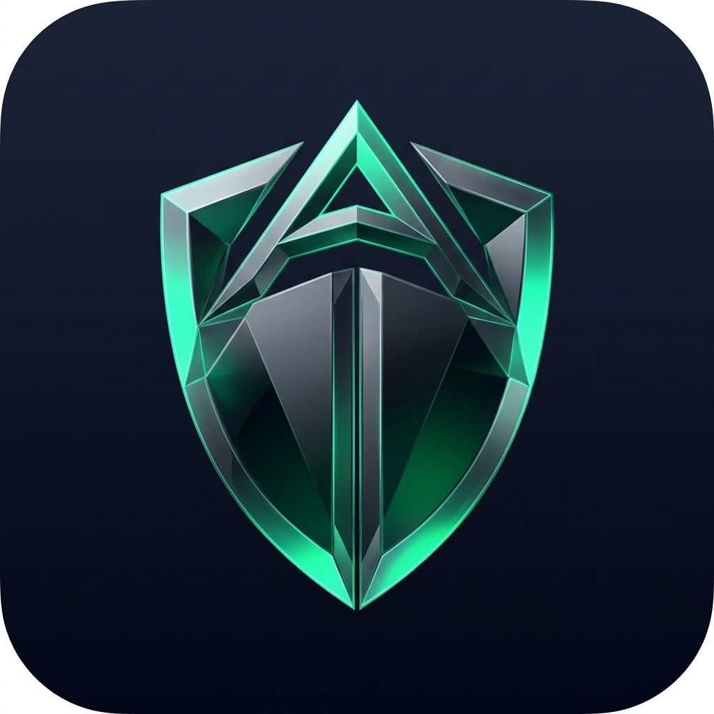
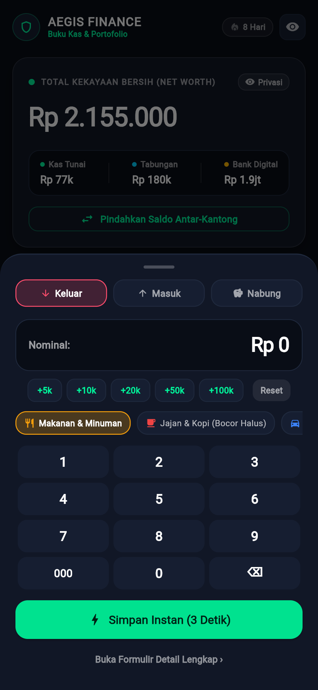

<p align="center">
  
</p>

<h1 align="center">Aegis Finance</h1>

<p align="center">
  <strong>The Sovereign Offline-First Personal Finance OS</strong><br>
  Lacak arus kas harian, tabungan, dan rekening bank digital tanpa registrasi akun, tanpa iklan, dan 100% tersimpan privat di perangkat Anda.
</p>

<p align="center">
  
  
  
  
  
  
  
</p>

---

## 📱 Tampilan Aplikasi

<table align="center">
  <tr>
    <td align="center"><b>💳 Beranda & Cincin</b></td>
    <td align="center"><b>⚡ Catat 3 Detik</b></td>
    <td align="center"><b>📊 Alokasi Kantong</b></td>
    <td align="center"><b>📅 Riwayat Kas</b></td>
    <td align="center"><b>🔒 PIN Vault</b></td>
  </tr>
  <tr>
    <td></td>
    <td></td>
    <td></td>
    <td></td>
    <td></td>
  </tr>
</table>

---

## 📥 Download APK Android (v1.4.1)

Pasang langsung di HP tanpa perlu login atau registrasi akun:

<p align="center">
  <a href="https://github.com/M-Aqilaz/Aegis-Finance-Track/releases/download/v1.4.1/AegisFinance-v1.4.1-arm64.apk">
    
  </a>
  &nbsp;&nbsp;
  <a href="https://github.com/M-Aqilaz/Aegis-Finance-Track/releases/download/v1.4.1/AegisFinance-v1.4.1-Universal.apk">
    
  </a>
</p>

> **💡 Rekomendasi:**
> - Gunakan versi **ARM64 (~21 MB)** untuk smartphone Android modern (keluaran 2018 ke atas: Samsung, Xiaomi, Poco, Vivo, Oppo, Infinix, dsb).
> - Gunakan versi **Universal (~57 MB)** jika memasang di perangkat lawas atau emulator Android.
>
> **Langkah Pemasangan:**
> 1. Unduh salah satu file APK di atas melalui browser HP.
> 2. Buka notifikasi unduhan lalu pilih **Install / Pasang**.
> 3. Buka Aegis Finance — seluruh data langsung aktif dan tersimpan privat 100% di perangkat Anda.

---

## 🎯 Mengapa Aegis Finance?

Sebagian besar aplikasi keuangan saat ini mewajibkan pembuatan akun, mengunggah catatan pribadi ke cloud pihak ketiga, dan dipenuhi iklan atau langganan bulanan. 

**Aegis Finance dirancang berbeda:**
1. **Nol Dependensi Cloud & Clean Slate**: Semua angka, catatan kas, dan mutasi saldo tersimpan murni di penyimpanan lokal HP Anda. Pengguna baru mulai dengan dompet bersih (Rp 0 di semua kantong) tanpa data acak.
2. **🛡️ Smart Essential vs Discretionary Safe Spending Quota**: Menghitung kuota jajan aman harian dengan pemilah cerdas antara **Kebutuhan Pokok** (Bensin, Makan Pokok, Tagihan, Obat) vs **Jajan/Gaya Hidup** (Bocor Halus). Pengeluaran kebutuhan wajib tidak akan memicu alarm panik merah, melainkan status Cyan `KEBUTUHAN POKOK` lengkap dengan chip rincian harian (*Pokok vs Jajan*).
3. **⚡ Multi-Tab Isolated Logging**: Catat pengeluaran, pemasukan, dan tabungan secara simultan dari modal taktil tanpa resiko angka bocor atau saling menimpa.
4. **📦 Kotak Pending Belanja (48-Hour Impulse Quarantine)**: Isolasi keinginan belanja non-pokok selama 48 jam untuk meredam nafsu impulsif. Uang yang batal dihamburkan bisa langsung dialokasikan ke target impian!
5. **🎯 Kantong Impian (Savings Goal Vault)**: Bikin target spesifik (Laptop, Dana Darurat, Liburan) dengan progress bar neon, kalkulator estimasi hari tercapai, dan proteksi penarikan impulsif.
6. **⚡ One-Liner Smart Command Bar**: Catat transaksi secepat mengetik chat (`nasi padang 25k`, `kopi 18k seabank`, `gaji 2jt`). Parser otomatis mengekstrak nominal, kategori, dan kantong bank target, lengkap dengan umpan balik sisa limit belanja harian secara real-time.
7. **⏳ Konversi Hari Hidup**: Tahu persis berapa hari jatah uang saku/biaya hidup yang setara dengan suatu barang yang ingin Anda beli (`Setara ~3.2 Hari Hidup`).
8. **👁️ Universal Privacy Eye**: Sensor saldo serentak di seluruh layar (Beranda, Kantong Aset, dan Riwayat) dengan sekali ketuk untuk kenyamanan saat berada di tempat umum.
9. **Multi-Kantong Saldo Nyata**: Pisahkan uang pegangan tunai (*Cash Stash*), brankas simpanan (*High-Yield Vault*), serta rekening bank digital (*SeaBank, Bank Jago, BCA, dll.*). Pindahkan dana antar-kantong secara instan.
10. **Cincin Finansial Harian**: Tiga cincin konsentris (*Catat Harian, Kendali Anggaran, dan Porsi Tabungan*) yang memberi umpan balik visual terhadap disiplin finansial Anda.
11. **Detektor Bocor Halus**: Algoritma lokal di tab Aset yang menganalisis frekuensi pengeluaran kecil berulang beserta rasio arus kas masuk, keluar, dan simpan.
12. **Proteksi PIN 4-Digit**: Lindungi privasi layar saat HP dipinjam teman atau keluarga dengan PIN vault mandiri.

---

## 🛠️ Pengembangan & Pengujian

Aplikasi dibangun menggunakan Flutter & Dart dengan cakupan uji logika (whitebox, blackbox, dan widget) komprehensif:

```bash
# Uji seluruh algoritma rekurensi saldo, parser perintah, dan keamanan PIN (40 tests)
flutter test

# Jalankan aplikasi di emulator / perangkat fisik
flutter run

# Kompilasi paket rilis Android (ARM64 & Universal)
flutter build apk --split-per-abi
flutter build apk
```

---

## 📄 Lisensi

Proyek ini dirilis di bawah lisensi **MIT**. Bebas dipelajari, dimodifikasi, dan dikembangkan kembali.

<p align="center">
  Dibuat dengan dedikasi oleh <strong>M. Aqilaz</strong>
</p>
