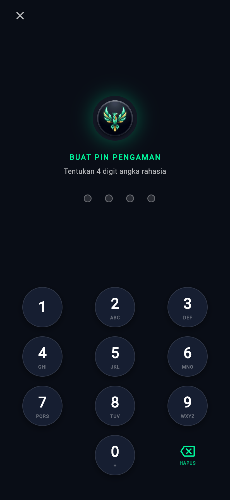

<p align="center">
  
</p>

<h1 align="center">Aegis Finance</h1>

<p align="center">
  <strong>Aplikasi Pembukuan & Manajemen Keuangan Pribadi 100% Offline-First</strong><br>
  Lacak arus kas harian, tabungan, dan rekening bank digital tanpa registrasi akun, tanpa iklan, dan tanpa server luar.
</p>

<p align="center">
  
  
  
  
  
  
</p>

---

## 📱 Tampilan Aplikasi

<table align="center">
  <tr>
    <td align="center"><b>💳 Beranda & Cincin</b></td>
    <td align="center"><b>⚡ Catat 3 Detik</b></td>
    <td align="center"><b>📊 Alokasi Kantong</b></td>
    <td align="center"><b>📅 Riwayat Kas</b></td>
    <td align="center"><b>🔒 PIN Vault</b></td>
  </tr>
  <tr>
    <td></td>
    <td></td>
    <td></td>
    <td></td>
    <td></td>
  </tr>
</table>

---

## 📥 Download APK Android

Pasang langsung di HP tanpa perlu login atau registrasi akun:

<p align="center">
  <a href="https://github.com/M-Aqilaz/Aegis-Finance-Track/releases/latest/download/AegisFinance-v1.1-arm64.apk">
    
  </a>
  &nbsp;&nbsp;
  <a href="https://github.com/M-Aqilaz/Aegis-Finance-Track/releases/latest/download/AegisFinance-Universal.apk">
    
  </a>
</p>

> **💡 Rekomendasi:**
> - Gunakan versi **ARM64 (~21 MB)** untuk smartphone Android modern (keluaran 2018 ke atas).
> - Gunakan versi **Universal** jika memasang di perangkat lama atau emulator.
>
> **Langkah Pemasangan:**
> 1. Unduh salah satu file APK di atas melalui browser HP.
> 2. Buka notifikasi unduhan lalu pilih **Install / Pasang**.
> 3. Buka Aegis Finance — data langsung aktif dan tersimpan aman di HP Anda.

---

## 🎯 Mengapa Aegis Finance?

Sebagian besar aplikasi keuangan saat ini mewajibkan pembuatan akun, mengunggah catatan pribadi ke cloud pihak ketiga, dan dipenuhi iklan atau langganan bulanan. 

**Aegis Finance dirancang berbeda:**
1. **Nol Dependensi Cloud**: Semua angka, catatan kas, dan mutasi saldo tersimpan murni di penyimpanan lokal HP Anda.
2. **Input Dua Mode Cepat**: Catat pengeluaran instan lewat numpad 3 detik di beranda, atau kelola rincian item dengan kategori lengkap di formulir detail.
3. **Multi-Kantong Saldo Nyata**: Pisahkan uang pegangan tunai (*Cash Stash*), brankas simpanan (*High-Yield Vault*), serta rekening bank digital (*SeaBank, Bank Jago, dll.*). Pindahkan dana antar-kantong secara instan.
4. **Cincin Finansial Harian**: Tiga cincin konsentris (*Catat Harian, Kendali Anggaran, dan Porsi Tabungan*) yang memberi umpan balik visual terhadap disiplin finansial Anda.
5. **Detektor Bocor Halus**: Algoritma lokal yang menganalisis frekuensi pengeluaran kecil berulang (kopi, cemilan harian) beserta estimasi dana yang bisa diselamatkan.
6. **Ekspor & Pindah HP Mandiri**: Ekspor seluruh buku kas ke format `.csv` untuk dibuka di Excel/Spreadsheets, atau gunakan cadangan terenkripsi sekali-klik saat berganti perangkat.
7. **Proteksi PIN 4-Digit**: Lindungi privasi layar saat HP dipinjam teman atau keluarga dengan PIN vault dan fitur sensor saldo instan (*Privacy Eye*).

---

## 🛠️ Pengembangan & Pengujian

Aplikasi dibangun menggunakan Flutter & Dart dengan cakupan uji logika (whitebox & blackbox) komprehensif:

```bash
# Uji seluruh algoritma dan rekurensi saldo (31 tests)
flutter test

# Jalankan aplikasi di emulator / perangkat fisik
flutter run

# Kompilasi paket rilis Android
flutter build apk --split-per-abi
```

---

## 📄 Lisensi

Proyek ini dirilis di bawah lisensi **MIT**. Bebas dipelajari, dimodifikasi, dan dikembangkan kembali.

<p align="center">
  Dibuat dengan dedikasi oleh <strong>M. Aqilaz</strong>
</p>
