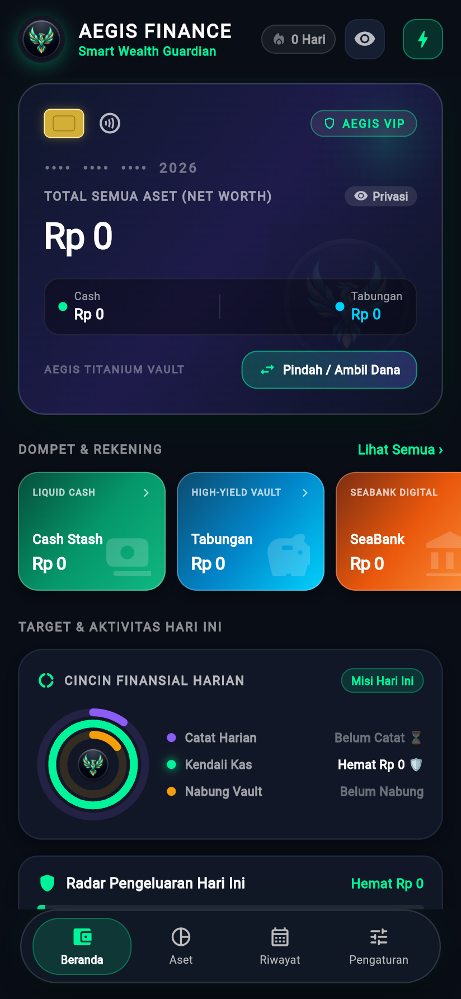
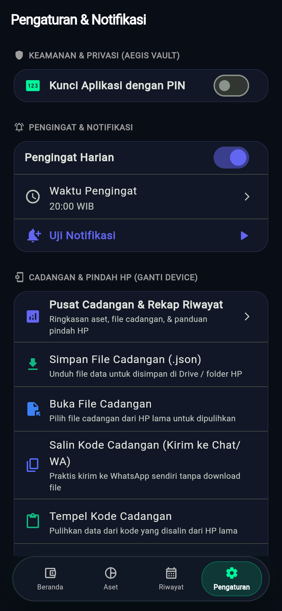

<p align="center">
  
</p>

<h1 align="center">🛡️ Aegis Finance</h1>

<p align="center">
  <strong>Smart Wealth Guardian & 100% Offline-First Personal Finance</strong><br>
  Aplikasi pembukuan keuangan modern dengan estetika <em>Obsidian Cosmic</em>, visual cincin aktivitas finansial ala <em>Apple Watch</em>, dan brankas privasi <em>Aegis Security Vault</em>.
</p>

<p align="center">
  
  
  
  
  
</p>

---

## 📥 Download Installer (APK Siap Pakai)

Tidak perlu setup Flutter atau compile source code dari nol. Unduh APK resmi dan pasang langsung di HP Android Anda:

<p align="center">
  <a href="https://github.com/M-Aqilaz/Aegis-Finance-Track/releases/latest/download/AegisFinance-Universal.apk">
    
  </a>
</p>

> **Panduan Install 3 Langkah:**
> 1. Klik tombol **Download APK** di atas (atau via [GitHub Releases](https://github.com/M-Aqilaz/Aegis-Finance-Track/releases/latest)).
> 2. Buka file `.apk` yang telah diunduh di HP Anda, lalu pilih **Izinkan instalasi**.
> 3. Selesai! Aplikasi langsung siap digunakan tanpa iklan, tanpa login, dan 100% offline.

---

## 📱 Visual Showcase

<table align="center">
  <tr>
    <td align="center"><b>Beranda (Net Worth)</b></td>
    <td align="center"><b>Riwayat & Filter</b></td>
    <td align="center"><b>Pengaturan & Cadangan</b></td>
    <td align="center"><b>PIN Security Vault</b></td>
  </tr>
  <tr>
    <td></td>
    <td></td>
    <td></td>
    <td></td>
  </tr>
</table>

---

## ✨ Fitur Unggulan

* 💳 **Black Titanium Card & Multi-Pocket**: Pantau kekayaan riil (*Net Worth*), sisa kas harian, tabungan vault, dan rekening bank (SeaBank, Bank Jago, dll) lengkap dengan fitur transfer dana antar kantong.
* 🟣🟢🟡 **Trio Cincin Finansial Konsentris**: Visualisasi radar Apple Watch untuk memantau konsistensi streak harian, kendali pengeluaran vs budget, dan progres target tabungan.
* 🔒 **Aegis Security Vault**: Kunci aplikasi dengan PIN 4-digit taktil, haptic feedback getar, sensor biometrik (sidik jari/Face ID), dan auto-lock saat aplikasi diminimalkan.
* 👁️ **Sensor Privasi Cepat (1-Tap)**: Seketika menyamarkan seluruh nominal angka saldo menjadi `Rp ••••••••` saat berada di kafe atau tempat umum.
* ⚡ **Pencatatan Kilat 3 Detik**: Numpad taktil dan chip angka instan (`+5k`, `+10k`, `+20k`, `+50k`, `+100k`) untuk mencatat transaksi harian tanpa buang waktu.
* 📅 **Riwayat & Filter Fleksibel**: Filter cepat (*Semua, Pengeluaran, Pemasukan, Simpan*) dan rincian transaksi harian yang dapat dibuka/tutup (*expandable*).
* 📲 **Pindah HP Tanpa Ribet**: Cadangkan data dan pulihkan di perangkat baru semudah menyalin kode ke WhatsApp pribadi atau menyimpan file cadangan. Tanpa istilah JSON yang membingungkan.
* 🔔 **Pengingat Harian Otomatis**: Notifikasi harian lokal terjadwal agar pembukuan tidak pernah terlewat.

---

<details>
<summary>📐 <b>Detail Matematis & Automated Test Suite (29/29 Passed)</b></summary>
<br>

Aegis Finance dibangun dengan invariant matematis ketat dan diuji dengan **29 unit test deterministik**:

| Metrik | Definisi | Rumus Invariant Matematis |
|---|---|---|
| **Sisa Kas (Cash)** | Kas cair operasional | $\text{Sisa}_t = \text{Sisa}_{t-1} + \text{In}_t - \text{Out}_t - \text{Save}_t + \Delta_{\text{transfer}}$ |
| **Total Simpan** | Brankas tabungan | $\text{TotalSimpan}_t = \text{TotalSimpan}_{t-1} + \text{Save}_t + \Delta_{\text{transfer}}$ |
| **Net Worth** | Total kekayaan bersih | $\text{NetWorth} = \text{Sisa} + \text{Total Simpan} + \sum \text{CustomAssets}$ |

Untuk menjalankan test:
```bash
flutter test
```
</details>

<details>
<summary>💻 <b>Panduan Developer (Build from Source)</b></summary>
<br>

```bash
# 1. Clone repository
git clone https://github.com/M-Aqilaz/Aegis-Finance-Track.git
cd Aegis-Finance-Track

# 2. Ambil dependensi
flutter pub get

# 3. Jalankan aplikasi
flutter run

# 4. Build release APK
flutter build apk --release
```
</details>

---

## 📜 Lisensi

Didistribusikan di bawah **MIT License**. Lihat file `LICENSE` untuk informasi selengkapnya.

<p align="center">
  Crafted with care by <strong>M.Aqilaz</strong>
</p>
